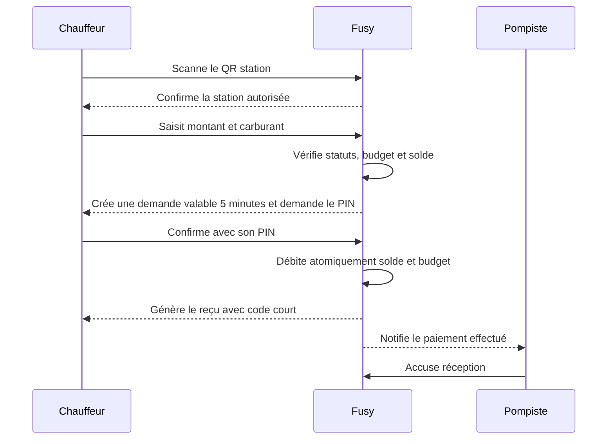

# Fondations produit Fusy

## Résumé

Fusy aide les entreprises camerounaises à remplacer les bons carburant papier et les avances cash par un compte carburant prépayé, des budgets attribués aux chauffeurs, une liste de stations autorisées et une confirmation digitale par PIN à la pompe.

Le MVP est B2B et fermé. Fusy crée les entreprises et les stations après accord commercial. Il ne s'agit pas d'un wallet grand public.

## Problème résolu

Les entreprises gèrent aujourd'hui de nombreuses dépenses carburant avec du cash, des bons papier et des justificatifs incomplets. Elles manquent de contrôle avant la dépense et de preuve exploitable après le passage en station.

Fusy doit rendre chaque dépense :

- autorisée avant exécution ;
- limitée par le budget du chauffeur et le solde réel de l'entreprise ;
- rattachée à une entreprise, un chauffeur, une station et un pompiste ;
- confirmée par le chauffeur avec son PIN ;
- historisée avec un reçu.

## Acteurs et responsabilités

| Acteur | Responsabilité dans le MVP |
|---|---|
| Admin Fusy | Crée les entreprises, stations et pompistes, crédite les comptes, autorise les stations et supervise les transactions. |
| Admin entreprise | Crée les chauffeurs, attribue les budgets et consulte les dépenses. |
| Chauffeur | Scanne la station, saisit le montant et confirme la transaction avec son PIN. Le débit est immédiat. |
| Pompiste | Consulte les paiements effectués de sa station et en accuse réception. Il ne valide, ne refuse ni ne modifie jamais une transaction. |

## Modèle financier visible dans l'interface

### Solde du compte carburant

Le solde entreprise représente l'argent réellement disponible. Il est alimenté manuellement par Fusy après réception et vérification d'un dépôt, virement ou transfert effectué hors plateforme.

### Budget chauffeur

Le budget chauffeur est une autorisation individuelle de dépense. Il ne crée pas et ne réserve pas d'argent.

Modes :

- manuel ;
- hebdomadaire ;
- mensuel.

Un renouvellement hebdomadaire ou mensuel remplace le reliquat. Il ne l'additionne pas. La somme des budgets chauffeurs peut dépasser le solde entreprise : c'est la sur-allocation autorisée.

Une transaction n'est possible que si le budget chauffeur et le solde entreprise couvrent tous les deux le montant.

## Stations autorisées

Chaque entreprise possède une liste unique de stations autorisées, commune à tous ses chauffeurs. Cette liste est configurée par Admin Fusy. Au MVP, il n'existe ni règle par chauffeur, ni horaire, ni zone GPS.

## QR fixe station

Chaque station dispose d'un QR fixe imprimé. Il identifie la station avec un token non devinable et ne contient aucun montant. L'app Chauffeur affiche le nom de la station après lecture et vérifie immédiatement son autorisation.

## Parcours transactionnel nominal

Le pompiste n'intervient jamais dans la confirmation : le paiement est déjà réglé par le PIN du chauffeur au moment où il apparaît dans l'app pompiste. Le pompiste consulte le paiement (montant, carburant, code) pour servir le carburant, puis en accuse réception. Il ne modifie, ne valide ni ne refuse rien.

## États de transaction

États réels du paiement (source : `app/Domain/Payments/PaymentStatus.php`).

| État métier | Libellé utilisateur | Sens |
|---|---|---|
| `pending` | À confirmer | Demande créée, le chauffeur doit saisir son PIN dans les cinq minutes. |
| `paid` | Payée | PIN confirmé, débits effectués, reçu généré. |
| `expired` | Expirée | Les cinq minutes sont dépassées sans confirmation PIN, aucun débit. |
| `failed` | Échouée | La confirmation a échoué (par exemple PIN bloqué), aucun débit. |
| `refunded` | Remboursée | Paiement remboursé a posteriori depuis le back-office Fusy. |

Un échec des **vérifications avant création** (voir ci-dessous) empêche la création : la transaction est **bloquée avant enregistrement**, aucun paiement n'existe alors dans ces états. Il n'existe **aucun état de validation ou de refus pompiste**.

## Vérifications avant création

- entreprise active ;
- chauffeur actif ;
- station active ;
- QR actif ;
- station autorisée pour l'entreprise ;
- montant strictement positif ;
- type de carburant valide ;
- budget chauffeur suffisant ;
- solde entreprise suffisant.

## Expiration

La fenêtre est de cinq minutes après création. L'expiration survient si le chauffeur ne confirme pas son PIN dans ce délai. Aucun débit n'a lieu.

## Reçu MVP

Le reçu contient entreprise, chauffeur, station, pompiste, montant, carburant, date et heure, identifiant de transaction, statut et code court.

## Principes de conception

- Montrer qui doit agir maintenant.
- Expliquer clairement pourquoi une action est bloquée.
- Distinguer autorisation de dépense et argent réellement disponible.
- Montrer le délai sans créer de panique inutile.
- Côté pompiste, distinguer clairement les paiements à accuser réception de ceux déjà accusés.
- Donner une preuve exploitable après chaque transaction payée.

## Hors périmètre

Wallet B2C, inscription publique, Mobile Money automatisé, microcrédit, carte des stations, promotions, KYC self-service, géolocalisation, départements, règles horaires, approbations multi-niveaux, gestion avancée des véhicules et BI avancée.
