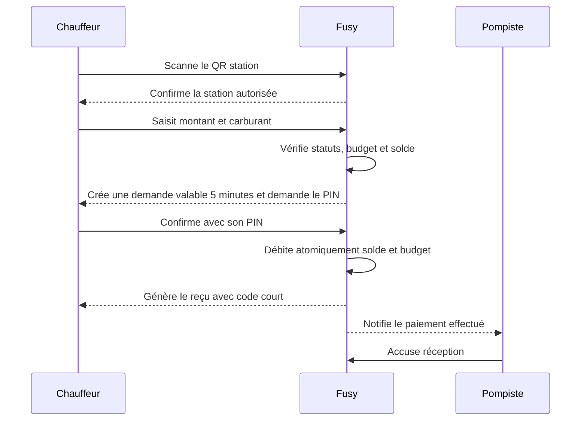

# App Mobile Fusy — Brief de conception COMPLET (fichier unique)

> **À donner tel quel à Claude Design ou Open Design.** Ce document décrit
> **l'application mobile Fusy en entier**, en un seul fichier.
> Joindre séparément le logo `assets/primary-logo.png` (le placer, ne pas le redessiner).
> **Ne pas** joindre `CDC_FINAL.md` (orientations hors MVP).

## Ce qu'il faut comprendre en premier

Fusy est **UNE seule application Flutter**. L'interface affichée dépend du **rôle du
compte connecté** :

- **Chauffeur** — consulte son budget, scanne une station autorisée, crée une demande
  carburant et **la confirme directement par PIN** (débit immédiat). Cible : **Android + iOS**.
- **Pompiste** — **consulte les paiements effectués** de sa station et en **accuse
  réception** pour servir le carburant. Il ne valide, ne refuse ni ne modifie jamais une
  transaction. Cible : **Android**.

Ce n'est **pas** deux applications distinctes : c'est **un seul produit, une seule base
de code, deux expériences** aiguillées après connexion selon le rôle. Le socle commun
(activation, connexion téléphone + PIN, marque, tokens, composants, accessibilité) est
**partagé par les deux rôles** et n'est décrit qu'une fois ci-dessous.

## Structure de ce document

1. **Fondations partagées** — produit, marque & tokens, accessibilité, assets (valables pour les deux rôles).
2. **Partie A — Expérience Chauffeur** — contexte, architecture, flows, écrans, états, données, qualité.
3. **Partie B — Expérience Pompiste** — idem.
4. **Prompt unifié** — l'instruction principale à exécuter pour concevoir l'app entière.

---

# 1. FONDATIONS PARTAGÉES (communes aux deux rôles)


<!-- ==== SOURCE: 00-shared/product-foundation.md ==== -->

# Fondations produit Fusy

## Résumé

Fusy aide les entreprises camerounaises à remplacer les bons carburant papier et les avances cash par un compte carburant prépayé, des budgets attribués aux chauffeurs, une liste de stations autorisées et une confirmation digitale par PIN à la pompe.

Le MVP est B2B et fermé. Fusy crée les entreprises et les stations après accord commercial. Il ne s'agit pas d'un wallet grand public.

## Problème résolu

Les entreprises gèrent aujourd'hui de nombreuses dépenses carburant avec du cash, des bons papier et des justificatifs incomplets. Elles manquent de contrôle avant la dépense et de preuve exploitable après le passage en station.

Fusy doit rendre chaque dépense :

- autorisée avant exécution ;
- limitée par le budget du chauffeur et le solde réel de l'entreprise ;
- rattachée à une entreprise, un chauffeur, une station et un pompiste ;
- confirmée par le chauffeur avec son PIN ;
- historisée avec un reçu.

## Acteurs et responsabilités

| Acteur | Responsabilité dans le MVP |
|---|---|
| Admin Fusy | Crée les entreprises, stations et pompistes, crédite les comptes, autorise les stations et supervise les transactions. |
| Admin entreprise | Crée les chauffeurs, attribue les budgets et consulte les dépenses. |
| Chauffeur | Scanne la station, saisit le montant et confirme la transaction avec son PIN. Le débit est immédiat. |
| Pompiste | Consulte les paiements effectués de sa station et en accuse réception. Il ne valide, ne refuse ni ne modifie jamais une transaction. |

## Modèle financier visible dans l'interface

### Solde du compte carburant

Le solde entreprise représente l'argent réellement disponible. Il est alimenté manuellement par Fusy après réception et vérification d'un dépôt, virement ou transfert effectué hors plateforme.

### Budget chauffeur

Le budget chauffeur est une autorisation individuelle de dépense. Il ne crée pas et ne réserve pas d'argent.

Modes :

- manuel ;
- hebdomadaire ;
- mensuel.

Un renouvellement hebdomadaire ou mensuel remplace le reliquat. Il ne l'additionne pas. La somme des budgets chauffeurs peut dépasser le solde entreprise : c'est la sur-allocation autorisée.

Une transaction n'est possible que si le budget chauffeur et le solde entreprise couvrent tous les deux le montant.

## Stations autorisées

Chaque entreprise possède une liste unique de stations autorisées, commune à tous ses chauffeurs. Cette liste est configurée par Admin Fusy. Au MVP, il n'existe ni règle par chauffeur, ni horaire, ni zone GPS.

## QR fixe station

Chaque station dispose d'un QR fixe imprimé. Il identifie la station avec un token non devinable et ne contient aucun montant. L'app Chauffeur affiche le nom de la station après lecture et vérifie immédiatement son autorisation.

## Parcours transactionnel nominal



Le pompiste n'intervient jamais dans la confirmation : le paiement est déjà réglé par le PIN du chauffeur au moment où il apparaît dans l'app pompiste. Le pompiste consulte le paiement (montant, carburant, code) pour servir le carburant, puis en accuse réception. Il ne modifie, ne valide ni ne refuse rien.

## États de transaction

États réels du paiement (source : `app/Domain/Payments/PaymentStatus.php`).

| État métier | Libellé utilisateur | Sens |
|---|---|---|
| `pending` | À confirmer | Demande créée, le chauffeur doit saisir son PIN dans les cinq minutes. |
| `paid` | Payée | PIN confirmé, débits effectués, reçu généré. |
| `expired` | Expirée | Les cinq minutes sont dépassées sans confirmation PIN, aucun débit. |
| `failed` | Échouée | La confirmation a échoué (par exemple PIN bloqué), aucun débit. |
| `refunded` | Remboursée | Paiement remboursé a posteriori depuis le back-office Fusy. |

Un échec des **vérifications avant création** (voir ci-dessous) empêche la création : la transaction est **bloquée avant enregistrement**, aucun paiement n'existe alors dans ces états. Il n'existe **aucun état de validation ou de refus pompiste**.

## Vérifications avant création

- entreprise active ;
- chauffeur actif ;
- station active ;
- QR actif ;
- station autorisée pour l'entreprise ;
- montant strictement positif ;
- type de carburant valide ;
- budget chauffeur suffisant ;
- solde entreprise suffisant.

## Expiration

La fenêtre est de cinq minutes après création. L'expiration survient si le chauffeur ne confirme pas son PIN dans ce délai. Aucun débit n'a lieu.

## Reçu MVP

Le reçu contient entreprise, chauffeur, station, pompiste, montant, carburant, date et heure, identifiant de transaction, statut et code court.

## Principes de conception

- Montrer qui doit agir maintenant.
- Expliquer clairement pourquoi une action est bloquée.
- Distinguer autorisation de dépense et argent réellement disponible.
- Montrer le délai sans créer de panique inutile.
- Côté pompiste, distinguer clairement les paiements à accuser réception de ceux déjà accusés.
- Donner une preuve exploitable après chaque transaction payée.

## Hors périmètre

Wallet B2C, inscription publique, Mobile Money automatisé, microcrédit, carte des stations, promotions, KYC self-service, géolocalisation, départements, règles horaires, approbations multi-niveaux, gestion avancée des véhicules et BI avancée.


<!-- ==== SOURCE: 00-shared/brand-and-ui-system.md ==== -->

# Marque et système UI Fusy

## Direction

La direction validée est **Clarté opérationnelle + Manrope**. Elle doit être sérieuse sans froideur, rassurante pour la finance et suffisamment directe pour un usage en station.

## Logo

Le logo combine un `F` géométrique, une flèche de progression et les couleurs bleu/vert. Ne pas redessiner, déformer, recolorer ou ajouter un effet au logo.

Sur fond clair, utiliser le logo principal. La zone de protection minimale correspond approximativement à la hauteur du jambage du `F`. Ne pas placer le logo dans une carte dense ou à proximité immédiate d'une autre marque.

Les sources disponibles sont des PNG aplatis, pas des SVG. Voir [assets-index.md](assets-index.md).

## Typographie

Famille unique : **Manrope**.

| Style | Taille / ligne | Poids | Usage |
|---|---:|---:|---|
| Display | 32 / 40 px | 700 | Solde ou montant principal |
| Titre 1 | 28 / 36 px | 700 | Titre d'écran |
| Titre 2 | 22 / 30 px | 700 | Section majeure |
| Titre 3 | 18 / 26 px | 600 | Carte ou sous-section |
| Corps large | 16 / 24 px | 400 | Message important mobile |
| Corps | 14 / 22 px | 400 | Contenu et tableaux |
| Libellé | 12 / 16 px | 600 | Champ, badge, navigation |
| Légende | 11 / 16 px | 500 | Métadonnée non critique |

Utiliser les chiffres tabulaires pour montants, dates, codes et colonnes numériques. Ne pas descendre sous 14 px pour une information critique.

## Palette

### Marque et neutres

| Token | Valeur | Usage |
|---|---|---|
| `brand.navy` | `#003362` | Bouton principal, navigation active |
| `brand.green` | `#00B473` | Accent et progression |
| `brand.greenDark` | `#007A4F` | Texte de succès |
| `neutral.900` | `#172B3A` | Texte principal |
| `neutral.700` | `#465B69` | Texte secondaire fort |
| `neutral.600` | `#5E6D78` | Texte secondaire |
| `neutral.500` | `#71808C` | Aide et métadonnée |
| `neutral.300` | `#9EAFBC` | Bordure forte |
| `neutral.200` | `#DCE4EA` | Bordure courante |
| `neutral.100` | `#EDF1F4` | Séparateur léger |
| `neutral.50` | `#F6F8FA` | Fond global |
| `white` | `#FFFFFF` | Surface |

### États

| État | Texte | Fond |
|---|---|---|
| Succès | `#007A4F` | `#E5F7EF` |
| Information | `#00598F` | `#E8F2F9` |
| Avertissement | `#915600` | `#FFF3DA` |
| Erreur | `#A52E2E` | `#FDECEC` |
| Destructif | `#C53939` | `#FDECEC` |

Le vert vif ne sert pas de petit texte sur blanc. Un état combine toujours couleur et libellé.

## Espacement et formes

Grille : `4`, `8`, `12`, `16`, `24`, `32`, `48`, `64` px.

- champs et boutons : rayon 8 px ;
- cartes : rayon 12 px ;
- modales : rayon 16 px ;
- feuilles mobiles : rayon supérieur 24 px ;
- bordure courante : 1 px `#DCE4EA` ;
- ombres réservées aux éléments flottants.

## Composants

### Boutons

- Principal : fond bleu, texte blanc, une seule action dominante par zone.
- Secondaire : fond blanc, bordure, texte bleu.
- Discret : texte bleu sans forte surface.
- Destructif : rouge, séparé des actions de validation.
- États obligatoires : normal, pressé, focus, chargement, désactivé.

### Champs

Libellé persistant, aide sous le contrôle, erreur près du champ. Le placeholder ne remplace pas le libellé. Montants et PIN ouvrent un clavier adapté.

### Cartes

Les cartes regroupent une seule idée. Préférer bordure et espace blanc aux ombres. Un montant principal possède un libellé explicite et `FCFA` visible.

### Statuts

Badges textuels courts alignés sur les états réels : `À confirmer` (pending), `Payée` (paid), `Expirée`, `Échouée`, `Remboursée`, plus `Bloquée` pour un échec de vérification avant création. Côté pompiste : `À accuser` / `Accusé`. Aucun badge de validation ou de refus pompiste.

### Iconographie

Icônes linéaires arrondies, trait optique de 2 px. Tailles : 20 px dans les contrôles, 24 px en navigation, 32 px en confirmation. Une icône ne remplace jamais le texte d'une action critique.

## Mobile terrain

- marge écran : 16 px ;
- cible tactile : 48 px minimum ;
- bouton principal : 48 à 52 px ;
- une action essentielle visible sans défilement lorsque possible ;
- navigation de trois à cinq destinations ;
- confirmation plein écran pour succès ou blocage critique.

## Dashboards

- navigation latérale sur grand écran ;
- grille de 12 colonnes ;
- marge de page : 24 à 32 px ;
- ligne de tableau : 48 px ;
- filtres visibles avant les données ;
- actions sensibles confirmées dans une modale ;
- état global visible dans l'en-tête du dossier.

## À éviter

Gradients décoratifs, glassmorphism, grandes ombres, cartes imbriquées, vert utilisé comme bouton principal partout, icônes seules pour les actions critiques, illustrations génériques de voitures, pompes ou billets.


<!-- ==== SOURCE: 00-shared/accessibility-and-content.md ==== -->

# Accessibilité et contenu

## Langue et ton

L'interface est en français. Le ton est direct, professionnel et rassurant. Préférer des phrases courtes et des verbes d'action.

Exemples :

- `Scanner une station` plutôt que `Démarrer le processus d'achat` ;
- `Budget insuffisant` plutôt que `Transaction impossible` ;
- `Aucun montant ne sera débité` après un blocage ou une expiration ;
- `Confirmez le paiement avec votre PIN.` plutôt que `Valider la transaction`.

## Terminologie stable

| Terme | Définition utilisateur |
|---|---|
| Compte carburant | Argent réellement disponible pour les dépenses de l'entreprise. |
| Budget chauffeur | Autorisation de dépense attribuée à un chauffeur. |
| Station autorisée | Station dans laquelle l'entreprise accepte les transactions. |
| Demande carburant | Transaction créée, en attente de la confirmation PIN du chauffeur. |
| Code court | Code à quatre chiffres permettant au pompiste de retrouver le paiement effectué. |
| Reçu | Preuve finale d'une transaction payée. |

Ne pas utiliser `wallet`, `crédit` ou `paiement effectué` lorsque le sens métier est budget, compte ou demande en attente.

## Formats

- Montant : `15 000 FCFA`, sans décimale.
- Téléphone affiché : `+237 6•• •• 45 89` lorsque le numéro complet n'est pas nécessaire.
- Date courte : `19 juin 2026`.
- Date avec heure : `19 juin 2026 à 14:32`.
- Identifiant : `TX-8F21K9`.
- Code court : `6821`, affiché en chiffres espacés visuellement.
- Durée : `Expire dans 04:32`.

## Messages d'erreur

Un message doit indiquer :

1. ce qui s'est passé ;
2. pourquoi lorsque l'information est sûre et utile ;
3. ce que l'utilisateur peut faire ;
4. si un débit a eu lieu.

Exemples :

- `Cette station n'est pas autorisée par votre entreprise. Choisissez une autre station. Aucun montant n'a été débité.`
- `Votre budget disponible est de 12 000 FCFA. Saisissez un montant inférieur ou contactez votre responsable.`
- `La demande a expiré. Créez une nouvelle demande pour continuer. Aucun montant n'a été débité.`
- `Connexion instable. Nous réessaierons automatiquement dès que le réseau revient.`

Ne pas exposer les codes d'erreur techniques dans le message principal. Ils peuvent apparaître dans un détail destiné au support.

## États à concevoir

Pour chaque écran concerné :

- chargement initial ;
- actualisation ;
- contenu normal ;
- liste vide avec prochaine action ;
- erreur récupérable ;
- erreur bloquante ;
- hors ligne ;
- session expirée ;
- permission refusée ;
- action en cours empêchant le double clic.

## Accessibilité

- Contraste WCAG AA pour textes et contrôles essentiels.
- Cible tactile minimale de 48 × 48 px.
- Focus clavier visible sur le web.
- Ordre de lecture logique et compatible lecteur d'écran.
- Libellé persistant pour chaque champ.
- Texte alternatif pour les images utiles ; logo annoncé comme `Fusy`.
- Statut jamais transmis uniquement par couleur.
- Erreur annoncée et liée au champ concerné.
- Modal avec focus piégé et retour du focus à la fermeture.
- Tableaux navigables au clavier avec en-têtes explicites.
- Minuterie accompagnée d'un libellé textuel et non d'une animation seule.

## Contenu fictif

Utiliser des données camerounaises plausibles sans reprendre de données personnelles réelles. Conserver les mêmes exemples entre les applications afin que les maquettes racontent une transaction cohérente.

## Checklist éditoriale

- Le sujet de l'action est clair.
- Le statut est compréhensible sans connaître les termes internes.
- `FCFA` est visible avec chaque montant critique.
- Le message précise l'absence de débit après blocage ou expiration.
- Le bouton décrit l'action, pas une réponse vague comme `Oui`.
- Les actions irréversibles nomment l'entité concernée.


<!-- ==== SOURCE: 00-shared/assets-index.md ==== -->

# Index des assets Fusy

## Logos disponibles

Les chemins sont relatifs à la racine du projet.

| Fichier | Dimensions | Usage prévu | Limite |
|---|---:|---|---|
| `assets/primary-logo.png` | 986 × 368 | Logo horizontal principal | Fond aplati, pas de transparence |
| `assets/logo-primary.png` | 1672 × 941 | Source raster haute définition | Grandes marges blanches |
| `assets/logo-monochrome.png` | 1448 × 1086 | Version bleu monochrome | Fond aplati |
| `assets/logo-monochrome-noire.png` | 1448 × 1086 | Impression monochrome noire | Fond aplati |
| `assets/app-icon.png` | 1254 × 1254 | Référence de l'icône d'app | Export RGB, extérieur noir à retraiter avant production |
| `assets/app-icon-1.png` | 1254 × 1254 | Doublon de référence | Même limite que `app-icon.png` |

Ces fichiers ne sont pas des originaux vectoriels. Claude Design doit les placer sans les redessiner. Il ne doit pas inventer une version SVG, une nouvelle flèche ou une nouvelle géométrie.

## Charte et spécifications

- Charte validée : `docs/superpowers/specs/2026-06-19-fusy-charte-graphique-mvp-design.md`
- Structure des briefs : `docs/superpowers/specs/2026-06-19-fusy-claude-design-briefs-design.md`
- Système UI synthétique : [`brand-and-ui-system.md`](brand-and-ui-system.md)

## Police

Police cible : Manrope Variable, graisses 400 à 700. Si le fichier local n'est pas encore fourni, Claude Design doit utiliser Manrope depuis sa bibliothèque sans la remplacer par une autre famille.

## Tokens de référence

Couleurs minimales :

```text
Primary       #003362
Accent        #00B473
Success text  #007A4F
Text          #172B3A
Background    #F6F8FA
Surface       #FFFFFF
Border        #DCE4EA
Warning text  #915600
Error text    #A52E2E
```

## Règles de transmission à Claude Design

Pour une génération, joindre de préférence :

1. `assets/primary-logo.png` ;
2. les quatre documents de `design-briefs/00-shared/` ;
3. tous les documents du dossier applicatif ;
4. le prompt applicatif en dernier.

Ne pas joindre `CDC_FINAL.md` en même temps : il contient des orientations historiques hors MVP susceptibles de provoquer l'ajout de fonctionnalités interdites.


---

# 2. PARTIE A — EXPÉRIENCE CHAUFFEUR (Flutter Android + iOS)


<!-- ==== SOURCE: 01-driver-app/01-product-and-user-context.md ==== -->

# Contexte produit et utilisateur — Chauffeur

## Utilisateur principal

Jean est chauffeur ou agent terrain d'une PME camerounaise. Son compte est créé par son responsable. Il utilise Fusy quelques fois par semaine, souvent debout près d'une pompe, sous forte luminosité et avec un réseau mobile irrégulier.

Il ne gère ni le compte entreprise, ni les stations autorisées. Son besoin est simple : savoir combien il peut dépenser et terminer le passage en station sans ambiguïté.

## Objectifs utilisateur

- Activer son compte sans assistance.
- Voir immédiatement son budget disponible.
- Comprendre si le compte de son entreprise est opérationnel.
- Identifier la bonne station par scan QR.
- Saisir correctement montant et carburant.
- Savoir qui doit agir pendant l'attente.
- Confirmer sans exposer son PIN.
- Retrouver une preuve après le plein.

## Craintes et erreurs probables

- Confondre budget chauffeur et argent personnel.
- Penser qu'une demande en attente est déjà payée.
- Scanner un QR désactivé ou une station non autorisée.
- Saisir un montant supérieur au budget.
- Quitter l'écran pendant l'attente du pompiste.
- Confirmer deux fois sous réseau lent.
- Ne pas comprendre une expiration.
- Refuser la permission caméra par erreur.

## Environnement

- Android bas ou milieu de gamme prioritaire, iPhone supporté.
- Utilisation à une main.
- Soleil, bruit, interruption par le pompiste.
- Données mobiles parfois lentes.
- Clavier numérique nécessaire pour montant, téléphone et PIN.
- Le chauffeur peut être peu familier avec les applications financières.

## Priorités de design

1. Budget et état du compte visibles dès l'accueil.
2. Une action principale : `Scanner une station`.
3. Étapes courtes avec progression claire.
4. Montant et station répétés avant confirmation.
5. Statut textuel et prochaine action toujours visibles.
6. Message rassurant sur l'absence de débit en cas d'échec.

## Permissions

Le chauffeur peut consulter uniquement son budget, ses transactions et ses reçus. Il ne voit pas le solde entreprise exact, les autres chauffeurs, les reversements ou les réglages de l'entreprise.


<!-- ==== SOURCE: 01-driver-app/02-scope-and-information-architecture.md ==== -->

# Périmètre et architecture — Chauffeur

## Fonctions MVP

- Activation avec téléphone et code.
- Création puis utilisation d'un PIN à quatre chiffres.
- Connexion par téléphone et PIN.
- Budget disponible et statut du compte entreprise.
- Scan du QR fixe d'une station.
- Vérification de la station autorisée.
- Saisie du montant et du type de carburant.
- Champ libre véhicule, plaque ou mission lorsqu'il est demandé.
- Création d'une demande valable cinq minutes.
- Confirmation du paiement avec PIN (débit immédiat).
- Historique personnel et reçus.

## Hors périmètre

Recharge, Mobile Money, wallet personnel, microcrédit, promotions, carte des stations, itinéraire, prix du carburant, gestion d'entreprise, gestion structurée des véhicules, push FCM et modification du numéro de téléphone.

## Navigation principale après connexion

```text
Accueil
├── Scanner une station
│   ├── Station reconnue
│   ├── Détails de la demande
│   ├── Confirmation PIN (récapitulatif + minuterie)
│   └── Reçu (avec code court)
├── Historique
│   └── Détail transaction / reçu
└── Profil
    ├── Identité et entreprise en lecture
    ├── Aide courte
    └── Déconnexion
```

Navigation inférieure recommandée : `Accueil`, `Historique`, `Profil`. Le scan reste l'action dominante de l'accueil, pas une quatrième destination abstraite.

## Architecture de l'activation

```text
Téléphone → Code d'activation → Créer le PIN → Confirmer le PIN → Accueil
```

Au retour, le chauffeur utilise `Téléphone → PIN`. Le code d'activation ne doit pas ressembler à un écran d'inscription publique.

## Hiérarchie de l'accueil

1. Salutation, nom et entreprise.
2. Budget disponible en grand.
3. État opérationnel ou blocage du compte entreprise.
4. Bouton `Scanner une station`.
5. Dernière transaction ou dernier reçu.
6. Aide contextuelle discrète.

## Règles de retour

- Avant création de la demande : retour possible sans conséquence.
- Après création : demander confirmation avant annulation, car la demande active court sur cinq minutes.
- Pendant la saisie du PIN : le retour ne doit pas perdre la demande active ni son minuteur.
- Une demande active doit être restaurée après fermeture ou reprise de l'app.


<!-- ==== SOURCE: 01-driver-app/03-user-flows.md ==== -->

# Parcours utilisateur — Chauffeur

## 1. Activation

**Précondition :** le responsable a créé Jean et un code d'activation est disponible.

1. Jean saisit son numéro.
2. L'app indique qu'un code lui a été envoyé ou remis.
3. Jean saisit le code.
4. Il crée un PIN à quatre chiffres puis le confirme.
5. L'app confirme l'activation et ouvre l'accueil.

Branches : code invalide, code expiré, numéro inconnu, PIN non identique, réseau indisponible. Aucun parcours d'inscription libre n'est proposé.

## 2. Connexion

1. Numéro prérempli lorsque l'app le connaît.
2. Saisie du PIN.
3. Accueil si le compte est actif.

Après plusieurs erreurs, afficher une temporisation et une voie de support ou de réactivation sans révéler d'information sensible.

## 3. Transaction nominale

1. Depuis l'accueil, Jean touche `Scanner une station`.
2. Il accorde la permission caméra si nécessaire.
3. Il scanne le QR de Tradex Bonamoussadi.
4. L'app affiche la station et confirme `Station autorisée`.
5. Jean saisit `15 000 FCFA`, choisit `Super` et renseigne éventuellement `LT-482-AA`.
6. Un récapitulatif affiche station, montant, carburant et budget après opération.
7. Jean crée la demande : l'app affiche un récapitulatif non modifiable et demande le PIN.
8. Un compteur `Expire dans 04:58` indique le délai pour confirmer.
9. Jean saisit son PIN pour confirmer le paiement, débité immédiatement.
10. L'app bloque le double envoi, attend le résultat et affiche le reçu avec le code `6821`.
11. Jean présente le reçu (code 6821) au pompiste Armand, qui le sert puis accuse réception dans son app.

## 4. Station non autorisée

Après scan, l'app affiche le nom de la station, le blocage, l'absence de débit et l'action `Scanner une autre station`. Aucun formulaire de montant n'est présenté.

## 5. Budget ou solde insuffisant

Le blocage intervient avant création. Le chauffeur voit la cause qu'il peut comprendre : son budget disponible ou l'indisponibilité du compte entreprise. Le solde exact de l'entreprise reste masqué.

## 6. Expiration avant confirmation

La minuterie atteint zéro avant que Jean n'ait confirmé son PIN. L'app affiche `Demande expirée`, l'absence de débit et un bouton `Créer une nouvelle demande`. Elle ne tente pas de prolonger silencieusement la demande.

## 7. PIN incorrect

Le récapitulatif reste visible, le champ PIN est vidé et l'erreur est annoncée. La minuterie continue. Après expiration, la confirmation devient impossible et aucun montant n'est débité.

## 8. Reprise après perte réseau

L'app conserve l'identifiant de la demande, affiche un bandeau hors ligne et resynchronise son statut. Elle ne crée jamais une deuxième demande automatiquement.

## 9. Historique et reçu

Jean parcourt une liste récente claire. Il ouvre une transaction, voit son statut, les acteurs, le montant et le code. Seules les transactions payées disposent d'un reçu final.


<!-- ==== SOURCE: 01-driver-app/04-screen-specifications.md ==== -->

# Spécifications des écrans — Chauffeur

## Gabarit mobile commun

Barre système native, en-tête simple, contenu défilable si nécessaire et action principale persistante en bas uniquement lorsqu'elle ne masque pas le clavier. Marge latérale 16 px. Afficher l'état réseau lorsqu'il influence le parcours.

## 1. Téléphone d'activation

**Objectif :** retrouver une invitation existante.  
**Contenu :** logo, titre `Activez votre compte`, indicatif `+237`, téléphone, aide.  
**Action :** `Continuer`.  
**États :** vide, numéro incomplet, numéro inconnu, chargement, hors ligne.  
**UX :** ne pas afficher `Créer un compte`.

## 2. Code d'activation

Six cases ou un champ segmenté, numéro masqué, délai et renvoi si disponible. Autoriser le collage. Erreur sans effacer inutilement tout le code.

## 3. Création du PIN

PIN à quatre chiffres, pavé numérique, explication `Ce PIN confirmera vos transactions`. Prévoir saisie puis confirmation, visibilité temporaire accessible et erreur de non-correspondance.

## 4. Connexion

Téléphone connu ou modifiable, PIN, action `Se connecter`, aide `PIN oublié ou compte non activé ?`. États : PIN incorrect, compte suspendu, session expirée, réseau.

## 5. Accueil

Afficher : `Bonjour Jean`, `TransLog Cameroun SARL`, budget `50 000 FCFA`, mode `Hebdomadaire`, état du compte entreprise, action `Scanner une station`, dernier reçu. Si le compte entreprise est suspendu ou indisponible, le bouton reste visible mais désactivé avec explication.

## 6. Permission caméra

Pré-permission claire expliquant l'usage. Après refus : illustration non obligatoire, texte, bouton `Autoriser la caméra` et lien vers réglages si refus permanent. Ne pas proposer la saisie manuelle d'un token QR au MVP.

## 7. Scanner QR

Vue caméra, cadre de scan, instruction `Placez le QR de la station dans le cadre`, lampe si disponible, retour. États : recherche, QR lu, QR invalide, caméra indisponible, hors ligne après lecture.

## 8. Résultat station

Nom, localisation textuelle courte si disponible et badge `Autorisée`. Si non autorisée, utiliser une page de blocage avec raison et action de rescan, sans afficher le formulaire.

## 9. Détails de la demande

Station verrouillée, champ montant numérique avec suffixe FCFA, choix `Super` ou `Gasoil`, champ libre optionnel véhicule/plaque/mission, budget disponible. Le bouton `Continuer` reste désactivé tant que les données sont invalides.

## 10. Récapitulatif

Répéter station, montant, carburant, information libre et budget estimé après opération. Action `Confirmer avec le PIN`, secondaire `Modifier`. Préciser que le débit intervient à la confirmation du PIN.

## 11. Confirmation PIN

Récapitulatif non modifiable (station, montant, carburant), minuterie restante `Expire dans 04:32`, saisie PIN à quatre chiffres et action `Confirmer 15 000 FCFA` (le nom du bouton inclut le montant). Anti double-envoi pendant la confirmation. Il n'existe aucun écran d'attente pompiste : la confirmation débite immédiatement.

## 12. Expiration

Page de résultat `Demande expirée`, cause lorsqu'elle est disponible, `Aucun montant n'a été débité`, et action adaptée : recommencer ou accueil.

## 13. Succès et reçu

État `Transaction payée`, montant, station, date/heure, carburant, ID, code court à présenter au pompiste, nom du pompiste et nouveau budget. Actions : `Voir le reçu` et `Retour à l'accueil`.

## 14. Historique

Liste groupée par date avec station, montant, carburant et statut. Les montants sont alignés. États : chargement, vide, erreur, pagination ou chargement progressif simple.

## 15. Détail transaction

Chronologie courte du statut, toutes les données du reçu, identifiant copiable et action de partage/téléchargement seulement si prévue par l'implémentation du reçu. Pour une transaction non payée, afficher `Ce document n'est pas un reçu final`.

## Écrans de blocage transversaux

- compte chauffeur suspendu ;
- compte entreprise suspendu ;
- budget insuffisant ;
- solde entreprise insuffisant sans afficher son montant ;
- station ou QR inactif ;
- transaction déjà traitée ;
- session expirée.

Chaque blocage nomme la cause, indique la prochaine action et confirme l'absence de débit lorsque pertinent.


<!-- ==== SOURCE: 01-driver-app/05-components-states-and-errors.md ==== -->

# Composants, états et erreurs — Chauffeur

## Composants spécifiques

### Carte Budget

Libellé `Budget disponible`, montant tabulaire, mode de renouvellement et prochaine date de remise à niveau si connue. Ne jamais la présenter comme un wallet rechargeable.

### Scanner

Cadre large, contraste élevé, instruction courte et retour haptique après lecture réussie. Aucun QR décoratif.

### Sélecteur de carburant

Deux grandes options exclusives : `Super` et `Gasoil`. Afficher texte et état sélectionné ; ne pas dépendre d'une icône ou d'une couleur seule.

### Champ Montant

Clavier numérique, regroupement des milliers à l'affichage, suffixe fixe `FCFA`, validation contre budget disponible. La valeur brute saisie reste stable pendant la frappe.

### PIN

Quatre positions, saisie masquée, erreur annoncée, clavier numérique et protection contre le double envoi. Ne jamais stocker ou afficher le PIN dans un récapitulatif.

### Code court et minuterie

Code très lisible, chiffres tabulaires, libellé `Code à présenter au pompiste`, affiché sur le reçu après paiement. La minuterie textuelle `Expire dans 04:32` accompagne l'écran de confirmation PIN, avec un avertissement sans clignotement agressif sous une minute.

### Carte Transaction

Station, date, carburant, montant, badge textuel. Toute la carte peut ouvrir le détail avec une cible accessible.

## États des actions

| État | Comportement |
|---|---|
| Normal | Action claire et disponible. |
| Pressé | Retour visuel et haptique léger. |
| Chargement | Libellé conservé ou remplacé par une formulation précise ; clic bloqué. |
| Désactivé | Contraste suffisant et raison visible à proximité. |
| Succès | Confirmation textuelle, pas uniquement une coche. |
| Erreur | Message près de la source et action de reprise. |

## Réseau

- Bandeau persistant `Connexion instable` lorsqu'une demande est active.
- Bouton `Réessayer` pour une opération sûre.
- Synchronisation automatique de statut sans créer une nouvelle demande.
- Si le résultat d'une confirmation est inconnu, afficher `Vérification du statut` plutôt que déclarer un échec.

## Messages prêts à utiliser

- QR invalide : `Ce QR n'est pas reconnu par Fusy. Scannez le QR officiel affiché dans la station.`
- Station non autorisée : `Votre entreprise n'autorise pas les achats dans cette station.`
- Budget insuffisant : `Votre budget disponible est de {budget}. Saisissez un montant inférieur ou contactez votre responsable.`
- Solde entreprise : `Le compte carburant de votre entreprise est temporairement insuffisant. Contactez votre responsable.`
- Expiration : `La demande a expiré après 5 minutes sans confirmation. Aucun montant n'a été débité.`
- PIN incorrect : `PIN incorrect. Vérifiez puis réessayez avant l'expiration.`
- Réseau : `Connexion instable. Nous vérifions le statut de votre demande.`

## État vide

Historique vide : `Aucune transaction pour le moment` puis `Votre premier reçu apparaîtra ici après une transaction payée.` L'action peut retourner à l'accueil, pas lancer automatiquement la caméra.


<!-- ==== SOURCE: 01-driver-app/06-content-and-sample-data.md ==== -->

# Contenu et données d'exemple — Chauffeur

## Identité

- Chauffeur : `Jean Mballa`
- Téléphone : `+237 6•• •• 45 89`
- Entreprise : `TransLog Cameroun SARL`
- Champ libre : `LT-482-AA · Livraison Akwa`

## Budget

- Mode : `Hebdomadaire`
- Budget disponible avant transaction : `50 000 FCFA`
- Transaction : `15 000 FCFA`
- Budget après transaction : `35 000 FCFA`
- Statut entreprise : `Compte opérationnel`

## Station et pompiste

- Station : `Tradex Bonamoussadi`
- Zone : `Douala, Bonamoussadi`
- Pompiste : `Armand Etoa`
- Carburant : `Super`

## Transaction nominale

- Code court : `6821`
- ID : `TX-8F21K9`
- Créée : `19 juin 2026 à 14:27`
- Payée : `19 juin 2026 à 14:28`

## Historique

| Date | Station | Carburant | Montant | Statut |
|---|---|---|---:|---|
| 19 juin, 14:28 | Tradex Bonamoussadi | Super | 15 000 FCFA | Payée |
| 17 juin, 09:14 | Neptune Logpom | Gasoil | 20 000 FCFA | Payée |
| 14 juin, 18:03 | Tradex Akwa | Super | 10 000 FCFA | Payée |
| 12 juin, 11:40 | MRS Deido | Gasoil | 18 000 FCFA | Expirée |

## Libellés d'actions

`Continuer`, `Scanner une station`, `Autoriser la caméra`, `Saisir les détails`, `Confirmer avec le PIN`, `Annuler la demande`, `Confirmer 15 000 FCFA`, `Créer une nouvelle demande`, `Voir le reçu`, `Retour à l'accueil`.

## Notifications in-app

- `Paiement confirmé. Présentez le code 6821 au pompiste.`
- `Transaction payée. Votre reçu est disponible.`
- `Demande expirée. Aucun montant n'a été débité.`


<!-- ==== SOURCE: 01-driver-app/07-responsive-accessibility-and-quality.md ==== -->

# Responsive, accessibilité et qualité — Chauffeur

## Viewports de conception

- Référence Android compacte : 360 × 800 px.
- Référence Android courante : 390 × 844 px.
- Référence iPhone : 393 × 852 px.
- Support minimal : largeur 320 px sans contenu tronqué.

## Règles de mise en page

- Une colonne, marge 16 px.
- Zone sûre respectée autour des encoches et barres système.
- Action principale accessible au pouce et non masquée par le clavier.
- Contenu essentiel visible en taille de texte système augmentée.
- Aucun tableau horizontal dans l'app.
- Montant et code ne se coupent pas sur deux lignes.

## Accessibilité

- Cibles de 48 × 48 px.
- Scanner avec instruction accessible au lecteur d'écran.
- PIN annoncé comme quatre positions sans lire les valeurs.
- Minuterie annoncée à intervalles raisonnables, pas chaque seconde.
- Focus déplacé vers le titre lors d'un changement d'étape.
- Erreurs liées aux champs et annoncées.
- Vibration jamais seule pour signaler une lecture ou un échec.

## Conditions terrain à montrer dans les maquettes

- permission caméra refusée ;
- réseau instable pendant l'attente ;
- texte long sur largeur 320 px ;
- clavier numérique ouvert ;
- moins d'une minute avant expiration ;
- app reprise avec demande active ;
- bouton de confirmation en chargement.

## Checklist visuelle

- Manrope uniquement.
- Bleu `#003362` comme action principale.
- Une seule action dominante par écran.
- `FCFA` visible avec les montants critiques.
- Station, montant et carburant répétés avant le PIN.
- Aucun dégradé décoratif.
- Aucun faux wallet ou action `Recharger`.
- Le vert indique succès/progression sans remplacer le texte.
- Le reçu final est clairement distinct d'une demande en attente.


---

# 3. PARTIE B — EXPÉRIENCE POMPISTE (Flutter Android)


<!-- ==== SOURCE: 02-attendant-app/01-product-and-user-context.md ==== -->

# Contexte produit et utilisateur — Pompiste

## Utilisateur

Armand est pompiste à Tradex Bonamoussadi. Son compte a été créé par Admin Fusy et rattaché à cette station. Il doit repérer un paiement effectué en quelques secondes et servir le carburant sans ralentir le service.

## Objectifs

- Ouvrir sa session de travail sur une pompe en début de service.
- Voir immédiatement les paiements effectués du jour dans sa station.
- Être averti d'un nouveau paiement et en accuser réception.
- Retrouver un paiement par son code court.
- Lire code, chauffeur, entreprise, montant et carburant pour servir le bon volume.
- Consulter l'activité du jour.

## Contraintes terrain

- Forte luminosité, bruit et mains parfois occupées.
- Téléphone Android d'entrée de gamme partagé ou dédié.
- Réseau mobile instable.
- Risque de confondre deux paiements.
- Le pompiste ne valide, ne refuse ni ne modifie jamais un paiement : il est déjà réglé par le PIN du chauffeur.

## Permissions

Armand voit uniquement les paiements et transactions de sa station. Il ne voit pas les soldes entreprises, budgets chauffeurs, autres stations, reversements globaux ou fonctions Admin Fusy.

## Priorités de design

Lisibilité à distance, code court et montant dominants, distinction nette entre paiement `À accuser` et paiement `Accusé`, station et session de travail toujours visibles. Ne jamais présenter d'action de validation ou de refus.


<!-- ==== SOURCE: 02-attendant-app/02-scope-and-information-architecture.md ==== -->

# Périmètre et architecture — Pompiste

## Fonctions MVP

- Connexion téléphone et PIN.
- Ouverture et fermeture d'une session de travail sur une pompe.
- Affichage de la station rattachée et du QR de la pompe en service.
- Liste des paiements effectués du jour pour la station.
- Accusé de réception d'un nouveau paiement.
- Recherche d'un paiement par code court.
- Détail en lecture seule.
- Historique du jour et total indicatif.
- État réseau simple.

## Hors périmètre

Validation ou refus d'une transaction, modification montant/carburant, création de compte, changement de station, encaissement, stock carburant, prix à la pompe, reversement, reporting multi-stations, scan QR, géolocalisation et gestion d'entreprise.

## Navigation

Navigation inférieure recommandée : `Paiements`, `Historique`, `Profil`.

```text
Connexion
└── Session de travail (choisir la pompe → QR de la pompe)
    └── Paiements du jour
        ├── Recherche code
        └── Détail paiement (lecture seule)
            └── Accuser réception → Accusé
Historique
└── Détail transaction
Profil
└── Station, session en cours, identité, fermer la session, déconnexion
```

L'écran `Paiements du jour` est la destination après ouverture de la session. La liste se met à jour sans rechargement manuel lorsque possible, et un nouveau paiement y apparaît en tête, marqué `À accuser`.


<!-- ==== SOURCE: 02-attendant-app/03-user-flows.md ==== -->

# Parcours utilisateur — Pompiste

## Connexion et ouverture de session

Armand saisit son téléphone et son PIN. Après succès, l'app affiche clairement `Tradex Bonamoussadi`. Il ouvre une session de travail sur une pompe (par exemple `Pompe 1`) ; l'app affiche le QR de la pompe et l'état réseau. Un compte suspendu ou non rattaché bloque l'accès avec une instruction de contacter le gérant ou Fusy.

## Consultation et accusé de réception (nominal)

1. Le paiement `6821` apparaît en tête des paiements du jour, marqué `À accuser`, avec Jean Mballa, TransLog Cameroun SARL, Super et `15 000 FCFA`.
2. Armand ouvre le paiement et lit le montant et le carburant à servir.
3. Il touche `Accuser réception`.
4. Le paiement passe au statut `Accusé` ; Armand sert le carburant correspondant.

Le paiement est déjà réglé au moment où il apparaît : il n'y a ni validation ni refus. L'accusé de réception ne débite ni n'annule rien ; il confirme seulement que le pompiste a vu la transaction.

## Recherche par code

Armand saisit quatre chiffres. Le paiement correspondant s'ouvre. Aucun résultat : message `Aucun paiement avec ce code aujourd'hui dans cette station` et possibilité de corriger.

## Nouveau paiement pendant le service

Un nouveau paiement effectué apparaît automatiquement en tête de liste, marqué `À accuser`, avec un rappel visuel discret. Si le pompiste ne l'accuse pas rapidement, Fusy envoie un SMS de secours ; l'accusé dans l'app lève ce rappel.

## Réseau instable

Un accusé envoyé affiche `Vérification du statut`. L'app empêche un second envoi et synchronise avant d'annoncer réussite ou échec.

## Mauvaise station

Les paiements d'une autre station ne sont jamais visibles. Un lien profond ou identifiant externe affiche une erreur d'autorisation sans révéler les détails.

## Fin de service

Armand ferme sa session de travail depuis le profil. La pompe n'est plus rattachée à sa session.


<!-- ==== SOURCE: 02-attendant-app/04-screen-specifications.md ==== -->

# Spécifications des écrans — Pompiste

## 1. Connexion

Logo, téléphone, PIN, bouton `Se connecter`, aide courte. États : erreur PIN, compte suspendu, non rattaché, hors ligne.

## 2. Ouverture de session

Après connexion, choisir la pompe pour ouvrir une session de travail. Afficher la station rattachée. Bouton `Ouvrir la session`. Si une session est déjà ouverte, proposer de la reprendre.

## 3. Session en cours / QR pompe

En-tête station + pompe, état réseau, QR de la pompe affiché en grand pour le scan par les chauffeurs, accès rapide aux paiements du jour et à la recherche par code, action `Fermer la session`.

## 4. Paiements du jour

Liste des paiements effectués de la station, le plus récent en tête. Chaque ligne affiche code court dominant, montant, carburant, chauffeur, entreprise, heure et un badge `À accuser` ou `Accusé`. État vide : `Aucun paiement aujourd'hui dans cette station`.

## 5. Recherche par code court

Clavier numérique, quatre positions, résultat exact. Autoriser correction rapide et soumission automatique après quatre chiffres sans empêcher le bouton explicite.

## 6. Détail paiement

Code, montant, carburant, chauffeur, entreprise, station, heure et identifiant. Toutes les valeurs sont en **lecture seule**. Si le paiement n'est pas encore accusé, bouton principal `Accuser réception`. Aucune action de validation, de refus ou de modification.

## 7. Confirmation d'accusé

Retour léger (feuille ou bandeau) : `Réception accusée`. Le paiement passe au badge `Accusé`. Aucun débit, aucune annulation ne découle de cette action.

## 8. Historique du jour

Résumé : nombre de paiements et montant total du jour. Liste avec filtre simple (tous / à accuser / accusés). Ne pas présenter le total comme un solde à retirer.

## 9. Détail transaction

Statut, chauffeur, entreprise, montant, carburant, date/heure, code, ID et rôle du pompiste. Le reçu final appartient au paiement payé.

## 10. Profil

Identité du pompiste, station, session de travail en cours, action `Fermer la session` et `Déconnexion`.


<!-- ==== SOURCE: 02-attendant-app/05-components-states-and-errors.md ==== -->

# Composants, états et erreurs — Pompiste

## Composants spécifiques

- Carte de paiement : code court dominant, montant, chauffeur, carburant, heure, badge `À accuser` / `Accusé`.
- Liste chronologique : le plus récent en tête, sans animation agressive.
- Recherche code court : quatre chiffres, clavier numérique.
- Détail en lecture seule : aucune apparence de champ éditable.
- Bouton unique `Accuser réception` (aucun bouton de validation ou de refus).
- Carte session de travail : station, pompe, QR, action `Fermer la session`.
- Bandeau réseau : connecté, instable, hors ligne, synchronisation.

## États critiques

- liste en chargement ;
- liste vide ;
- nouveau paiement reçu (à accuser) ;
- paiement déjà accusé sur un autre appareil ;
- accusé envoyé mais statut inconnu (réseau) ;
- aucune session de travail ouverte ;
- session ou compte suspendu.

## Messages

- `Aucun paiement avec le code 6821 aujourd'hui dans cette station.`
- `Réception accusée.`
- `Ce paiement a déjà été accusé. Actualisez la liste.`
- `Connexion instable. Nous vérifions si votre accusé a été enregistré.`
- `Ouvrez une session de travail sur une pompe pour commencer.`

Le bouton ne doit jamais devenir `Servir le carburant` ni `Valider` : l'app sert à consulter les paiements effectués et à en accuser réception, pas à autoriser ni à gérer physiquement le service.


<!-- ==== SOURCE: 02-attendant-app/06-content-and-sample-data.md ==== -->

# Contenu et données d'exemple — Pompiste

## Session

- Pompiste : `Armand Etoa`
- Téléphone : `+237 6•• •• 12 43`
- Station : `Tradex Bonamoussadi`
- Pompe en service : `Pompe 1`
- État réseau : `Connexion stable`

## Paiements du jour

| Code | Chauffeur | Entreprise | Carburant | Montant | Heure | Statut |
|---|---|---|---|---:|---:|---|
| 6821 | Jean Mballa | TransLog Cameroun SARL | Super | 15 000 FCFA | 14:28 | À accuser |
| 4176 | Aïcha Ndom | SafeGuard SARL | Gasoil | 25 000 FCFA | 13:52 | Accusé |
| 9034 | Paul Essama | BuildCam SA | Gasoil | 40 000 FCFA | 12:07 | Accusé |

## Historique du jour

- Paiements du jour : `18`
- Montant total encaissé : `346 000 FCFA`
- À accuser : `1`
- Accusés : `17`

## Libellés

`Rechercher un code`, `Accuser réception`, `Ouvrir la session`, `Fermer la session`, `Retour aux paiements`, `Voir l'historique du jour`.


<!-- ==== SOURCE: 02-attendant-app/07-responsive-accessibility-and-quality.md ==== -->

# Responsive, accessibilité et qualité — Pompiste

## Viewports

Concevoir d'abord à 360 × 800 px, vérifier à 320 px de large et 390 × 844 px. Android est prioritaire.

## Terrain

- Contraste élevé sous forte luminosité.
- Code et montant lisibles sans approcher le téléphone.
- Bouton `Accuser réception` de 48 px minimum, facile à atteindre au pouce.
- Pas de geste caché pour une action métier.
- Liste utilisable avec 0, 1, 5 et 20 paiements.
- Mise à jour de statut sans saut de mise en page perturbant.

## Accessibilité

Lecteur d'écran : annoncer code, montant, carburant, chauffeur et statut (`à accuser` / `accusé`) dans un ordre stable. Confirmer verbalement l'accusé de réception.

## Checklist

- Station et pompe en service toujours visibles.
- Montant et carburant jamais éditables.
- Distinction claire entre `À accuser` et `Accusé`.
- Aucune action de validation ou de refus présentée.
- État réseau visible sans couvrir les actions.
- Manrope et palette Fusy respectées.
- Aucune fonction Admin ou reversement.


---

# 4. PROMPT UNIFIÉ — instruction principale à exécuter

Conçois **l'application mobile Fusy complète** pour le **MVP B2B fermé** de gestion des
budgets carburant au Cameroun. C'est **une seule application Flutter** dont l'interface
dépend du rôle du compte connecté : **Chauffeur** (Android + iOS) ou **Pompiste**
(Android). Respecte tous les documents ci-dessus. Utilise `assets/primary-logo.png` sans
le redessiner.

## Direction visuelle non négociable (les deux rôles)

- Style : clarté opérationnelle, sérieux B2B mais accessible, très lisible en extérieur.
- Police unique : **Manrope** (400–700).
- Bleu principal `#003362`, vert accent `#00B473`, fond `#F6F8FA`, surfaces blanches.
- Thème clair uniquement. Aucun gradient décoratif, glassmorphism ni grande ombre.
- Montants au format `15 000 FCFA`, chiffres tabulaires.
- Cibles tactiles ≥ 48 px. Chaque statut combine **couleur + texte**.

## Règle métier essentielle (à ne pas confondre)

Le chauffeur **paie directement** : scan du QR d'une station autorisée → saisie
montant/carburant → **confirmation par PIN qui débite immédiatement** le compte
entreprise et le budget. La demande **expire après 5 min** si le PIN n'est pas saisi.
Aucun débit après blocage ou expiration. Le **pompiste ne valide ni ne refuse rien** :
au moment où un paiement apparaît dans son app, il est **déjà réglé**. Le pompiste
**consulte** le paiement (code, montant, carburant) pour servir le carburant et en
**accuse réception**. États réels du paiement : `pending` (à confirmer) → `paid` →
`expired` / `failed` / `refunded`. Il n'existe **aucun** état de validation pompiste.

## Architecture d'app (aiguillage par rôle)

Conçois d'abord le **socle commun** : splash, activation par téléphone, saisie du code
d'activation, création/confirmation du PIN, connexion. Après connexion, **le rôle du
compte détermine l'expérience** : accueil Chauffeur ou espace Pompiste. Montre clairement
cet embranchement. Ne demande jamais de « choisir un rôle » : il découle du compte.

## Écrans — rôle Chauffeur

Accueil budget, permission caméra, scanner QR, résultat station autorisée / non
autorisée, saisie montant + type carburant + champ libre, récapitulatif, **confirmation
PIN avec minuterie (débit immédiat)**, expiration, succès/reçu **avec code court à
présenter au pompiste**, historique et détail transaction. Il n'y a **pas** d'écran
d'attente pompiste.

## Écrans — rôle Pompiste

Connexion, **ouverture de session de travail sur une pompe** (+ QR de la pompe et état
réseau), **liste des paiements du jour** (badge `À accuser` / `Accusé`), recherche par
code court, **détail de paiement en lecture seule** avec action **`Accuser réception`**,
confirmation d'accusé, historique du jour + total, profil avec **fermeture de session**.
Aucun écran de validation, de refus ou d'attente de PIN chauffeur.

## États obligatoires

Chargement, vide, hors ligne, réseau instable ; côté chauffeur : permission caméra
refusée, QR invalide, station non autorisée, budget insuffisant, compte entreprise
insuffisant ou suspendu, PIN incorrect, expiration avant confirmation, envoi en cours
anti-double-envoi, reprise avec demande active ; côté pompiste : nouveau paiement à
accuser, paiement déjà accusé sur un autre appareil, accusé au statut inconnu, aucune
session ouverte, compte suspendu.

## Données d'exemple

Chauffeur : Jean Mballa, TransLog Cameroun SARL, budget hebdomadaire 50 000 FCFA,
transaction 15 000 FCFA (Super), code 6821, ID TX-8F21K9, 19 juin 2026.
Pompiste : Armand Etoa, Tradex Bonamoussadi, Pompe 1.

## Sortie attendue

1. **Architecture de navigation unique** montrant le socle commun puis l'embranchement Chauffeur / Pompiste.
2. Maquettes haute fidélité **390 × 844 px** (vérifiées aussi à **360 × 800 px**).
3. **Tous** les écrans des deux rôles + les variantes critiques d'états.
4. **Composants réutilisables** (boutons, champs, cartes, badges de statut, minuterie, code court, saisie PIN) avec états normal, pressé, focus, chargement, désactivé, erreur.
5. Courtes annotations des décisions et transitions clés.

## Interdictions

N'ajoute pas : validation/refus pompiste, écran d'attente pompiste côté chauffeur,
recharge, Mobile Money, wallet B2C, microcrédit, promotions, carte des stations,
itinéraire, géolocalisation, KYC, gestion d'entreprise, scan QR côté pompiste,
modification de montant, stock/prix carburant, encaissement, reversement, reporting
multi-stations, fonctions Admin Fusy, ni sélection manuelle de rôle. N'invente aucune
couleur, police ou variante de logo.
